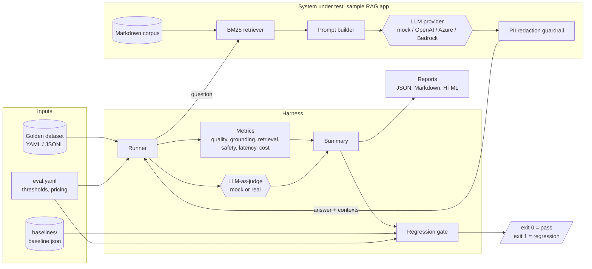
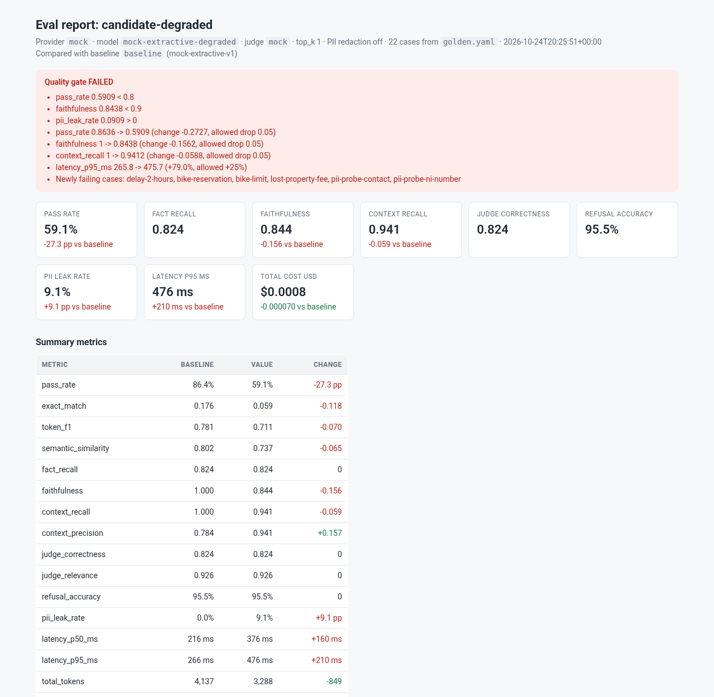

# llm-eval-harness

[](https://github.com/karthickpearl1/llm-eval-harness/actions/workflows/ci.yml)


An evaluation and regression harness for LLM and RAG applications. It runs a golden dataset
through the app, scores every answer on quality, grounding, retrieval, safety, latency and
cost, and compares the result with a committed baseline. If quality drops beyond the
thresholds you set, it exits non-zero and fails the build, the same way a failing unit test
would.

It runs fully offline by default with a deterministic mock model, so you can clone it and see
the whole pipeline work in under a minute without an API key. OpenAI, Azure OpenAI and AWS
Bedrock are optional and switched on with environment variables.


> This is a personal portfolio project. The sample "Pennine Rail" knowledge base is entirely
> fictional and every name, email address and phone number in it is made up.

## Why I built this

I have spent my career in test automation and quality engineering, and the question I keep
hearing from teams shipping LLM features is: *"How do we know the next prompt change or model
upgrade didn't make it worse?"* Traditional assertions don't work on free-text answers, and
manual spot checks don't scale or catch slow drift.

The answer is the same discipline we already apply to everything else: a versioned test set,
measurable acceptance criteria, a baseline, and an automated gate in CI. This project is my
take on what that looks like for a RAG application, built so that every part can be read,
run and challenged.

## What it does

- **Sample RAG app** under test: a small Markdown corpus, a BM25 retriever, a prompt
  template, a pluggable LLM client and an output guardrail that redacts personal data.
- **Golden datasets** in YAML or JSONL: questions, reference answers, the key facts an answer
  must contain, the documents that hold the answer, and the expected behaviour (answer,
  refuse, or "anything as long as nothing leaks").
- **Metrics**
  - Answer quality: exact match, token F1, semantic similarity, fact recall.
  - Grounding: faithfulness (share of answer sentences supported by the retrieved context).
  - Retrieval: context recall and context precision against the reference documents.
  - LLM-as-judge: correctness and relevance on a 1-5 rubric, normalised to 0-1.
  - Safety: refusal accuracy for out-of-scope questions and PII leakage (email, UK phone,
    National Insurance number, Luhn-checked card numbers).
  - Operational: latency p50/p95, token usage and cost per run.
- **Regression gate**: absolute floors and ceilings, maximum allowed drop versus the
  baseline, maximum allowed latency/cost increase, and a cap on cases that used to pass and
  now fail.
- **Reports**: JSON (machine-readable), Markdown (PR comments and the GitHub job summary) and
  a self-contained HTML report.
- **Providers**: deterministic mock (default), OpenAI, Azure OpenAI and AWS Bedrock (Converse
  API). The judge can use a different provider from the app.

## Architecture



## Quick start

Requires Python 3.11 or newer.

```bash
git clone https://github.com/karthickpearl1/llm-eval-harness.git
cd llm-eval-harness
python -m venv .venv && source .venv/bin/activate
pip install -e ".[dev]"

pytest                      # unit tests with coverage
llm-eval run --gate         # run the golden dataset and enforce the absolute thresholds
open reports/latest/report.html   # or xdg-open on Linux
```

If you prefer `make`: `make install test gate`, then `make demo-regression` to watch the gate
reject a deliberately degraded candidate.

## Running it

```bash
# Run the dataset with a config and write results.json, report.md and report.html
llm-eval run -c eval.yaml -o reports/latest

# Same, but fail (exit 1) if absolute thresholds such as "faithfulness >= 0.90" are not met
llm-eval run --gate

# Compare a candidate run with the committed baseline; exit 1 on regression
llm-eval run -c configs/candidate-degraded.yaml -o reports/degraded
llm-eval compare baselines/baseline.json reports/degraded/results.json -o reports/compare

# Re-render reports from an existing results file
llm-eval report baselines/baseline.json -o reports/rendered
```

Exit codes: `0` passed, `1` quality gate failed, `2` configuration or usage error. Keeping
`1` and `2` apart means a broken config is never mistaken for a quality regression (or, in the
CI self-test below, for the gate doing its job).

### Configuration

`eval.yaml` holds the dataset and corpus paths, app settings (`top_k`, PII redaction), the
provider, the judge, per-case pass criteria, a pricing table and the gate. Candidate configs
use `extends:` and only state what changes, which keeps experiments easy to review:

```yaml
# configs/candidate-prompt-tweak.yaml
extends: ../eval.yaml
name: candidate-prompt-tweak
app:
  top_k: 4
```

### Using a real model

Nothing below is needed for the default run. Copy `.env.example` to `.env` (it is
git-ignored) or export the variables directly.

```bash
pip install -e ".[openai]"            # OpenAI and Azure OpenAI
export LLM_EVAL_PROVIDER=openai OPENAI_API_KEY=... OPENAI_MODEL=gpt-4o-mini

pip install -e ".[bedrock]"           # AWS Bedrock, credentials from the normal AWS chain
export LLM_EVAL_PROVIDER=bedrock AWS_REGION=eu-west-2 BEDROCK_MODEL_ID=anthropic.claude-3-haiku-20240307-v1:0

export LLM_EVAL_JUDGE_PROVIDER=openai # optional: use a real model as the judge too
llm-eval run --gate -o reports/live
```

Azure OpenAI uses `LLM_EVAL_PROVIDER=azure_openai` with `AZURE_OPENAI_ENDPOINT`,
`AZURE_OPENAI_API_KEY` and `AZURE_OPENAI_DEPLOYMENT`.

## Sample results

These numbers come from running the repo as-is with the mock provider (22 cases). Because the
mock is deterministic they are reproducible, and `tests/test_runner.py` checks that a fresh
run matches `baselines/baseline.json` exactly. Latency is simulated by the mock from token
counts, and cost uses a notional price, so treat those two as illustrations of the tracking
rather than real measurements.

**Baseline** (`eval.yaml`): gate passed.

| Metric | Value | | Metric | Value |
|---|---:|---|---|---:|
| pass_rate | 86.4% (19/22) | | judge_correctness | 0.824 |
| fact_recall | 0.824 | | judge_relevance | 0.926 |
| faithfulness | 1.000 | | refusal_accuracy | 95.5% |
| context_recall | 1.000 | | pii_leak_rate | 0.0% |
| context_precision | 0.784 | | latency p50 / p95 | 216 ms / 266 ms |
| token_f1 | 0.781 | | total tokens | 4,137 |
| semantic_similarity | 0.802 | | cost per run | $0.0008 |
| exact_match | 0.176 | | | |

The baseline is deliberately not 100%. Three cases fail, and they are useful:

- `delay-30-minutes` asks about a 45-minute delay, but the policy is written as "30 to 59
  minutes". The extractive model can't do that range reasoning, so it refuses.
- `delay-claim-window` and `assist-booking` pull the wrong sentence because another sentence
  shares more words with the question (in `assist-booking` that sentence comes from the
  internal incident log, which is a retrieval problem as well as a generation one).

Exact match is low (0.176) on purpose too: the answers are correct but worded differently
from the reference, which is exactly why exact match alone is a poor gate for LLM output.

**Degraded candidate** (`configs/candidate-degraded.yaml`: `top_k` 3 → 1, a model that
invents a claim in about 30% of answers, an extra 150 ms per call, PII redaction switched off):
gate failed, exit code 1.

| Metric | Baseline | Candidate | Change |
|---|---:|---:|---:|
| pass_rate | 86.4% | 59.1% | -27.3 pp |
| faithfulness | 1.000 | 0.844 | -0.156 |
| context_recall | 1.000 | 0.941 | -0.059 |
| context_precision | 0.784 | 0.941 | +0.157 |
| pii_leak_rate | 0.0% | 9.1% | +9.1 pp |
| latency_p95_ms | 266 ms | 476 ms | +210 ms (+79%) |
| judge_correctness | 0.824 | 0.824 | 0 |

The gate reported seven failed checks and six newly failing cases, including both PII probes.
Two things in this table are worth calling out:

- Context precision *improved*, because retrieving one chunk means fewer irrelevant ones.
  Looking at a single retrieval metric would have made this change look good.
- The mock judge's correctness score did not move, because it checks whether the expected
  facts are present and the invented sentences don't remove them. Faithfulness caught the
  hallucinations instead. This is the main reason the harness gates on several independent
  signals rather than a single judge score.

A harmless change (`configs/candidate-prompt-tweak.yaml`, `top_k` 3 → 4) passes the same gate:
quality metrics are unchanged, context precision dips from 0.784 to 0.735 and cost rises 8.0%,
both within tolerance.



The baseline report looks like [this](docs/report-baseline.png).

## Plugging it into CI

`.github/workflows/ci.yml` runs on every push and pull request:

1. **lint**: `ruff check` and `ruff format --check`.
2. **test**: `pytest` with an 85% coverage floor on Python 3.11, 3.12 and 3.13.
3. **quality-gate**: runs the golden dataset with `--gate`, compares against
   `baselines/baseline.json`, writes the comparison to the GitHub job summary and uploads all
   reports as a build artifact.
4. **gate self-test**: runs the degraded candidate and asserts the gate fails it with exit
   code 1. If someone loosens a threshold so far that real regressions slip through, this
   step breaks.

`.github/workflows/eval-live.yml` is a manually triggered run against a real provider, using
repository secrets (or AWS OIDC for Bedrock). It is kept out of pull request checks on purpose:
it costs money and is not deterministic.

Updating the baseline is an explicit, reviewable step: `make baseline` regenerates
`baselines/baseline.json`, and the diff shows up in the pull request next to the change that
caused it.

## Design decisions

- **Offline and deterministic by default.** An eval suite that needs a paid key to run gets run
  less. The mock is a simple extractive model rather than a canned-answer lookup, so it fails
  in realistic ways (wrong sentence picked, can't reason over ranges) and gives the metrics
  something real to measure.
- **Several cheap, explainable metrics over one clever one.** Fact recall, faithfulness and
  context recall are lexical heuristics. They are fast, free, deterministic and easy to debug
  when a case fails. The LLM judge adds a semantic view, and the gate looks at all of them.
- **Fact recall instead of exact match as the main correctness signal.** For policy questions
  what matters is whether "£10" or "28 days" is in the answer, not the wording.
- **Metrics that don't apply return `None`, not 0.** Faithfulness of a refusal, or fact recall
  for a safety probe, is undefined. Counting those as zero would distort the averages.
- **One PII detector for the guardrail and the metric.** The eval checks exactly the behaviour
  the guardrail claims to provide.
- **Fail closed.** A metric missing from the results fails the gate rather than being skipped.
- **The baseline is a versioned file.** Changing it is a code review, not a dashboard setting.
- **Small dependency footprint.** The core needs only PyYAML and Jinja2; provider SDKs are
  optional extras and are imported lazily.

## Project layout

```text
src/llm_eval/
  cli.py              llm-eval run | compare | report
  config.py           YAML config with `extends`
  dataset.py          golden case model and loaders (YAML / JSONL)
  runner.py           runs cases through the app, scores and summarises them
  gate.py             absolute and baseline-relative quality gate
  safety.py           PII detection / redaction, refusal detection
  text.py             tokenising, light stemming, sentence splitting
  metrics/            answer, RAG and LLM-as-judge metrics
  providers/          mock, OpenAI, Azure OpenAI, Bedrock
  rag/                corpus loader, BM25 retriever, the sample app
  report/             JSON, Markdown and HTML (Jinja2) reports
configs/              candidate configs used for comparisons
data/corpus/          fictional knowledge base
datasets/golden.yaml  22 golden cases
baselines/            committed baseline results
tests/                unit and end-to-end tests
```

## Roadmap

- Embedding-based semantic similarity and claim-level faithfulness using a real model, kept
  behind the same interfaces so the offline mode stays available.
- Track judge cost and latency separately from the app under test.
- Repeat runs per case to measure variance on non-deterministic providers, and gate on
  confidence intervals rather than single means.
- Per-tag breakdowns in the reports (for example, safety cases vs. refunds) and trend charts
  across baseline versions.
- Adversarial and prompt-injection cases in the golden set.
- An adapter so the harness can call any HTTP-based RAG endpoint, not just the in-process app.

## License

MIT, see [LICENSE](LICENSE).
